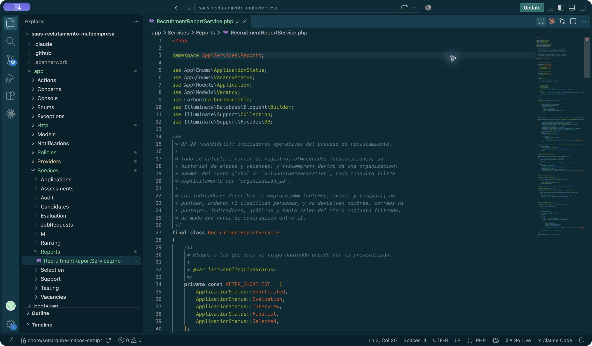

# Arquitectura tecnológica

> Actividad 2 de la guía. Versiones **medidas con comandos** el 09/11/2026 en la Mac del estudiante (macOS 27.2, arm64) y dentro del contenedor `app`. Salvo que se indique, no se tomaron de documentación anterior. Comandos utilizados: `php -v`, `php artisan --version`, `composer --version`, `node -v`, `npm -v`, `npx tsc -v`, `vendor/bin/phpunit --version`, `postgres --version`, `redis-server --version`, `docker --version`, `docker compose version`, `git --version`, `sonar-scanner --version`, `GET /api/system/status` de SonarQube, más la lectura de `composer.lock` y `node_modules/*/package.json` dentro del contenedor.

## 1. Tabla de tecnologías

| Componente | Tecnología | Versión | Propósito | Justificación |
|---|---|---|---|---|
| Frontend | React + TypeScript | React 19.3.0 · TypeScript 5.9.3 | Construcción de la interfaz | Componentes tipados; React Compiler (`babel-plugin-react-compiler`) para memoización automática |
| Frontend (estilos) | Tailwind CSS + Radix UI + lucide-react | Tailwind 4.3.3 · lucide-react 0.475.0 | Diseño, accesibilidad e iconos | Primitivas accesibles (Radix) y tokens de tema claro/oscuro en `resources/css/app.css` |
| Capa cliente–servidor | Inertia.js (+ Wayfinder) | `@inertiajs/react` 3.7.1 · `inertiajs/inertia-laravel` 3.3.4 · `laravel/wayfinder` 0.1.21 | Integrar React con Laravel sin una API REST separada | Un solo despliegue y autorización en el servidor; rutas tipadas en TS |
| Backend | PHP | 8.4.25 (contenedor) | Lógica de negocio | Versión soportada por Laravel 13 |
| Framework | Laravel | 13.31.0 | Estructura MVC, ORM Eloquent, colas, validación, Policies | Ecosistema maduro para SaaS multiempresa (scopes globales, Gates, Fortify) |
| Autenticación | Laravel Fortify + passkeys | Fortify 1.39.0 · `@laravel/passkeys` 0.2.0 | Inicio de sesión, 2FA y passkeys | Seguridad de acceso sin desarrollo propio |
| Base de datos | PostgreSQL | 17.11 (imagen `postgres:17.11-alpine`) | Almacenamiento transaccional | `CHECK`, FK, trigger *append-only* de auditoría y subconsultas para reportes |
| Caché, sesión y colas | Redis | 7.4.11 (imagen `redis:7.4.11-alpine`), extensión `phpredis` | Sesiones, caché y cola de notificaciones | Desacopla las notificaciones de la petición HTTP |
| Gestión de dependencias | Composer · npm | Composer 2.10.3 · npm 10.9.8 · Node 22.23.2 (contenedor) | Instalación reproducible desde `composer.lock` y `package-lock.json` | Builds deterministas |
| Build frontend | Vite + Vite Plus | Vite 8.3.0 · vite-plus 0.3.0 | Compilación, `vp check` (Oxlint/Oxfmt) y `vp test` | Herramienta oficial del starter kit de Laravel |
| Entorno de desarrollo | macOS + terminal zsh + Docker Desktop + Claude Code (CLI) | macOS 27.2 arm64 | Edición, ejecución y asistencia al desarrollo | Los comandos del proyecto se ejecutan en contenedores; no se modifica el runtime del host. VS Code se verificó abierto con la estructura del repositorio y el servicio de reportes; captura real `evidencias/arquitectura/ARQ-TECH-09_IDE_VSCode.jpg`. No se afirma que sea el único editor histórico |
| Control de versiones | Git + GitHub | Git 2.54.0 (Apple Git-157) · remoto `github.com/luivmz/saas-reclutamiento-multiempresa` | Gestión de cambios, ramas y PR | Flujo `main`/`develop`/`feature|fix|docs|chore/*`, tags académicos |
| Servidor / infraestructura | Docker Engine + Docker Compose | Docker 29.7.2 · Compose v5.5.1 · imagen `reclutamiento-php:dev` (PHP 8.4 bookworm) | Ejecutar `app`, `queue`, `postgres`, `redis` y el perfil E2E | Entorno idéntico entre integrantes y CI |
| Integración continua | GitHub Actions | `.github/workflows/tests.yml` (PHP 8.4, Node 22.23.2, servicio PostgreSQL 17.11) | Build, `tsc` y PHPUnit en pushes a `main`, `develop`, `release/**`, `fix/**`, Pull Requests y ejecución manual | Regresión automática antes de integrar |
| Automatización de pruebas | **Cypress** | 15.3.0 (imagen `cypress/included:15.3.0`, navegador Electron) | Pruebas E2E sobre la aplicación real | Ejecuta flujos completos en un entorno aislado (`app-e2e`, BD `reclutamiento_e2e`) |
| Pruebas backend | PHPUnit | 12.5.35 (+ PCOV 1.0.12 para cobertura) | Pruebas unitarias y de integración (Feature) sobre PostgreSQL real | Reglas de negocio, autorización y cross-tenant |
| Pruebas frontend | Vitest | 4.1.11 | Pruebas de componentes y utilidades TS | Rápidas y sin navegador |
| Análisis estático complementario | Larastan · Pint · Oxlint/Oxfmt | Larastan 3.12.0 · Pint 1.32.1 | Tipos PHP, estilo PHP y lint/formato TS | Deuda documentada en `docs/sonarqube/RESULTADOS_SONARQUBE_MAC.md` |
| Análisis de calidad | **SonarQube** Community Build + SonarScanner CLI | Servidor 26.10.0.133078 (contenedor `sonarqube`, `localhost:9000`) · Scanner 8.1.0.6389 | Evaluación estática, Quality Gate y cobertura importada | Métricas de fiabilidad, seguridad y mantenibilidad, y cobertura Clover de PHPUnit |
| Servicio experimental (opcional) | Python + FastAPI + scikit-learn | Ver `ml-service/` | Riesgo de demora del proceso (RF-29) | Desactivado por defecto; fuera de Compose |

## 2. Diagrama de arquitectura tecnológica

Se reutiliza `02_DESPLIEGUE_DOCKER` como diagrama principal, complementado por `11_ESTRATEGIA_PRUEBAS_CALIDAD`, `16_FLUJO_GIT_DESARROLLO` y `01_ARQUITECTURA_GENERAL_SAAS`. Las rutas, páginas y su vigencia están en [`DIAGRAMAS_REFERENCIA.md`](DIAGRAMAS_REFERENCIA.md).

## 3. Entorno de trabajo y despliegue

### 3.1 Entorno de desarrollo

- **Host**: macOS 27.2 sobre Apple Silicon (arm64), con Docker Desktop. PHP, Composer y Node del proyecto se ejecutan **dentro** del contenedor `app` (ver `CLAUDE.md`, «Comandos habituales»).
- **Herramientas en el host**: Git, SonarScanner CLI (Homebrew) y Google Chrome (solo para renderizar vistas de diagramas).
- **Asistencia**: Claude Code, gobernado por `CLAUDE.md` y las skills del proyecto (`project-guardian`, `laravel-saas-quality`…).

### 3.2 Gestión del código fuente

Git con remoto en GitHub. Ramas largas `main` (publicada) y `develop` (integración); trabajo en ramas `feature/*`, `fix/*`, `docs/*` o `chore/*`. Esta práctica se desarrolló en `chore/sonarqube-macos-setup` **sin commits**, pendiente de auditoría humana. Tags académicos `v1.0.0-academic` y `v1.1.0-academic` (inmutables).

### 3.3 Procedimiento para ejecutar la aplicación

```sh
open -a Docker                                    # Docker Desktop
docker compose up -d --wait                       # app, queue, postgres, redis (healthchecks)
curl -fsS http://localhost:8000/health            # {"status":"ok","checks":{"database":"ok","redis":"ok"}}
# Se conserva la BD local existente; no se necesita reiniciarla para esta práctica.
```

La aplicación queda en `http://localhost:8000`. El `entrypoint` del contenedor instala dependencias desde los *locks* si faltan, compila el frontend si falta el manifiesto y ejecuta `migrate --force` (`docker/php/entrypoint.sh`). Los usuarios demo están en [`docs/demo-users.md`](../../demo-users.md).

### 3.4 Infraestructura

| Servicio Compose | Imagen | Puerto host | Rol |
|---|---|---|---|
| `app` | `reclutamiento-php:dev` | `8000` | Laravel (`php artisan serve`) y assets compilados |
| `queue` | `reclutamiento-php:dev` | — | `queue:work redis` (notificaciones) |
| `postgres` | `postgres:17.11-alpine` | `127.0.0.1:5432` | Base de datos |
| `redis` | `redis:7.4.11-alpine` | `127.0.0.1:6379` | Sesión, caché y colas |
| `app-e2e`, `queue-e2e` (perfil `e2e`) | `reclutamiento-php:dev` | `127.0.0.1:8001` | App aislada para Cypress (`APP_ENV=e2e`) |
| `cypress` (perfil `e2e`) | `cypress/included:15.3.0` | — | Ejecutor de la suite E2E |
| `sonarqube` (fuera de Compose) | `sonarqube:community` | `9000` | Servidor de análisis local (H2 embebido, solo evaluación) |

**No hay despliegue productivo ni en la nube.** El sistema se ejecuta localmente en Docker con fines académicos y datos ficticios: cualquier publicación productiva está bloqueada por la gobernanza vigente (`CLAUDE.md`, «Estado vigente F34E»).

### 3.5 Procedimiento para actualizar o publicar nuevas versiones

1. Rama de trabajo desde `develop`; cambios con pruebas (TDD para reglas nuevas).
2. Regresión local: `php artisan test`, `npm run build`, `npx tsc --noEmit`, Vitest y Cypress cuando se toca un flujo.
3. Commit, *push* y Pull Request hacia `develop` **solo con autorización del equipo**. GitHub Actions (`tests.yml`) ejecuta build, TypeScript y PHPUnit.
4. Integración `develop` → `main` y, si corresponde, tag académico, también con autorización explícita.
5. En cada máquina: `git pull` y `docker compose up -d --wait`. El `entrypoint` aplica las migraciones nuevas.

Esta práctica se detiene en el paso 2: los cambios quedan en el working tree para la auditoría humana.

## 4. Verificación Codex y evidencia del IDE

Se confirmó VS Code con el árbol del proyecto y el código de Reportes visibles, sin editar archivos desde la UI:



El servicio experimental RF-29 continúa **desactivado** (`ml.enabled=false`), fuera del Compose principal; no se inició para esta auditoría. `/health` verifica PostgreSQL y Redis del entorno normal. El entorno de Cypress usa exclusivamente `reclutamiento_e2e`; PHPUnit fuerza `reclutamiento_testing`.

Las referencias locales de Git siguen distintas: `main=8a00505`, `origin/main=b8892af`. Son referencias consultadas sin fetch, pull, checkout, merge ni rebase; no se afirma que `origin/main` sea una lectura nueva del remoto. Ninguna de esas ramas fue modificada.
