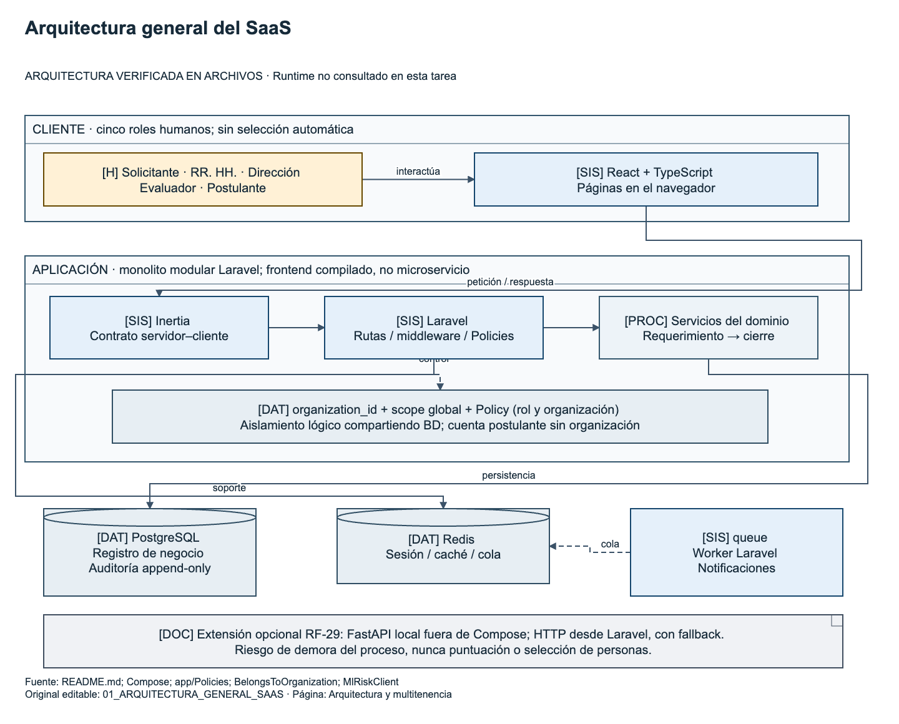
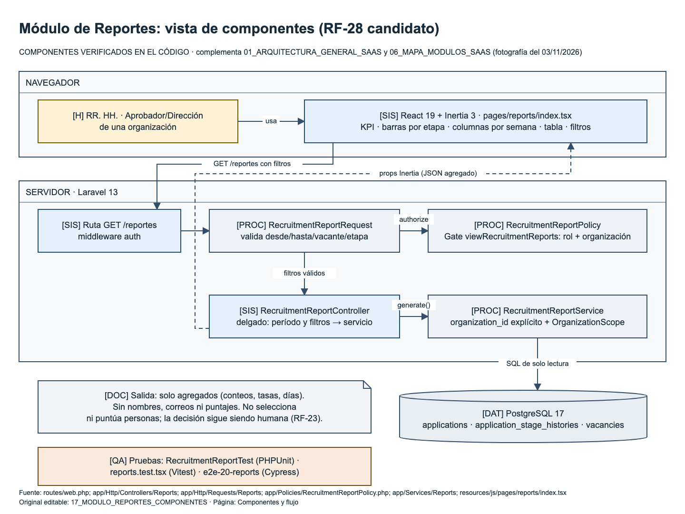
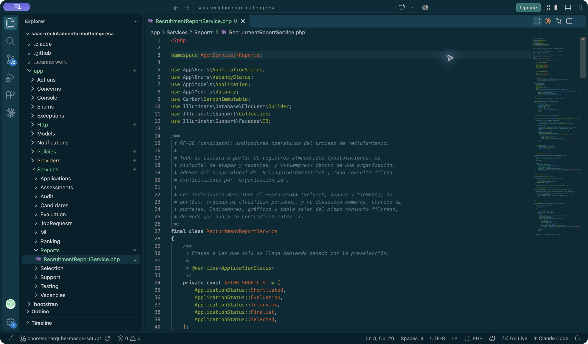
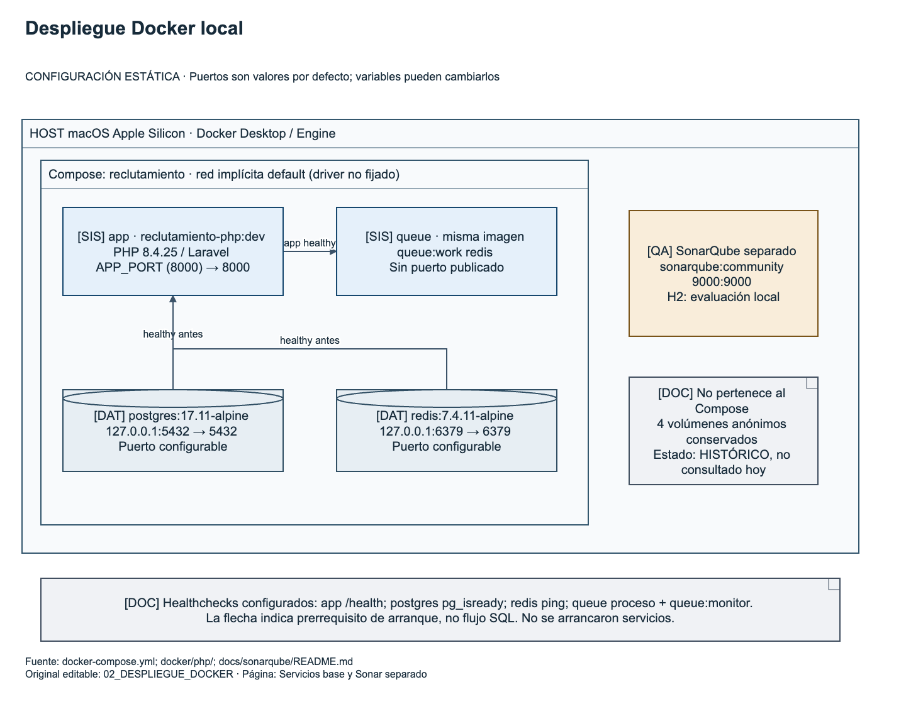
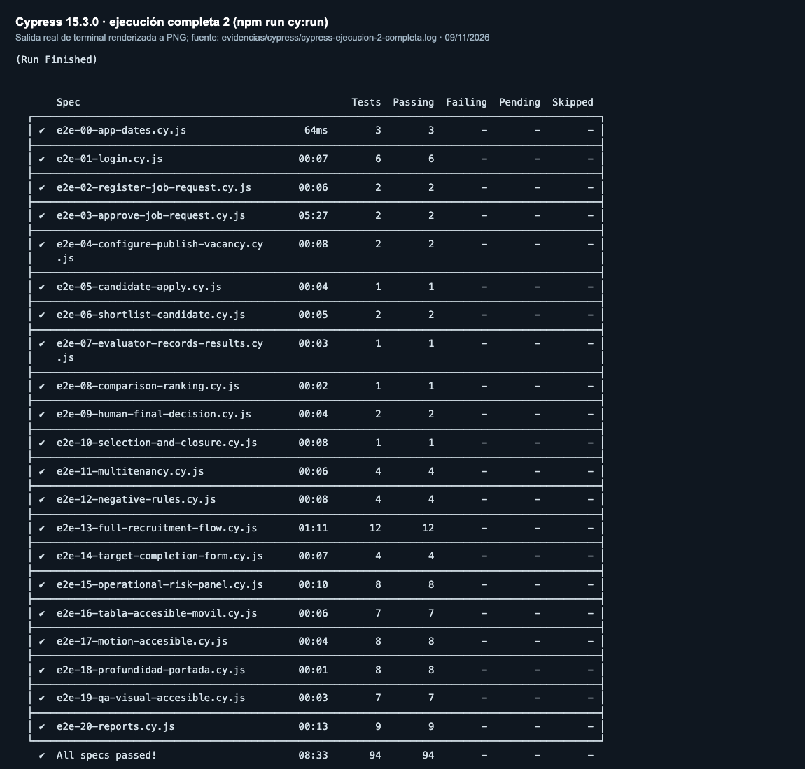
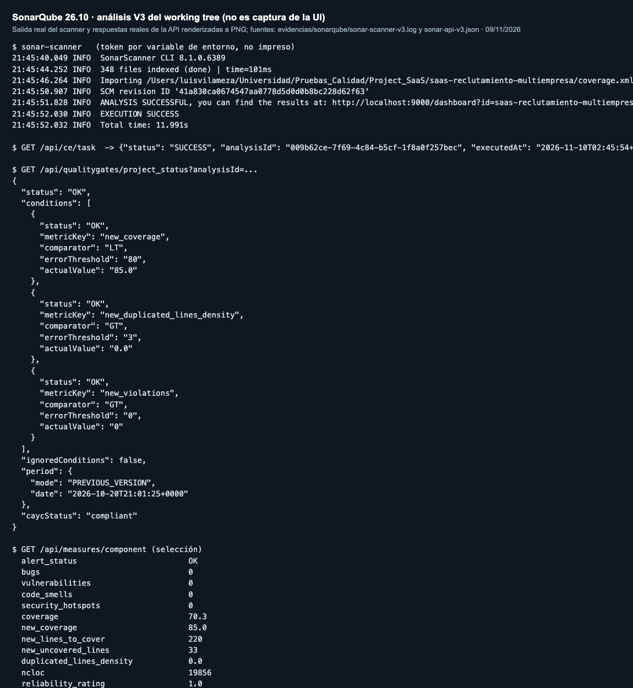
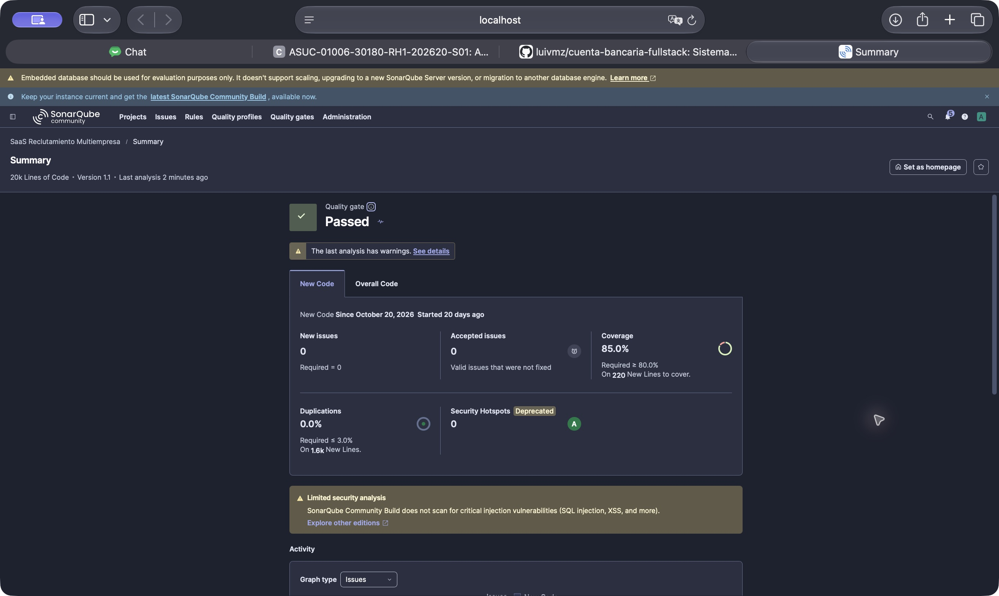
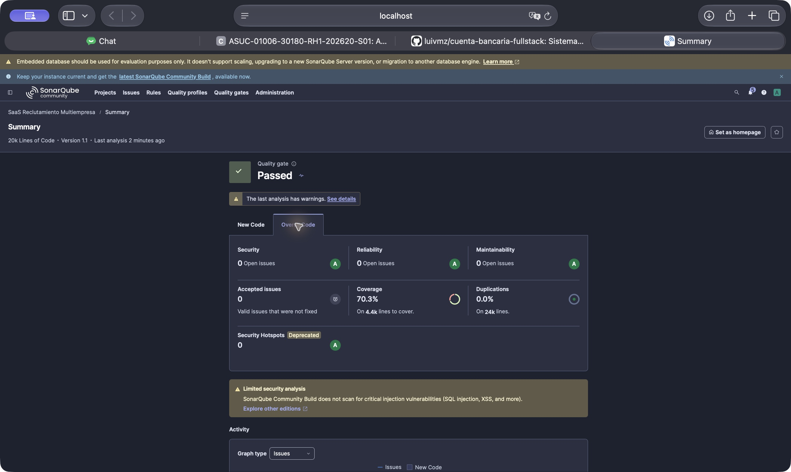
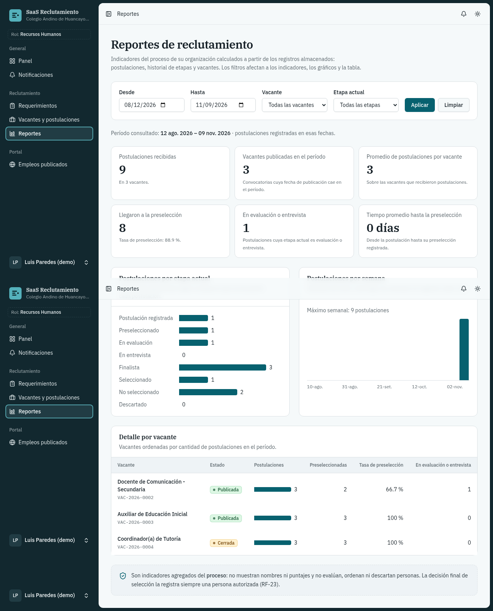
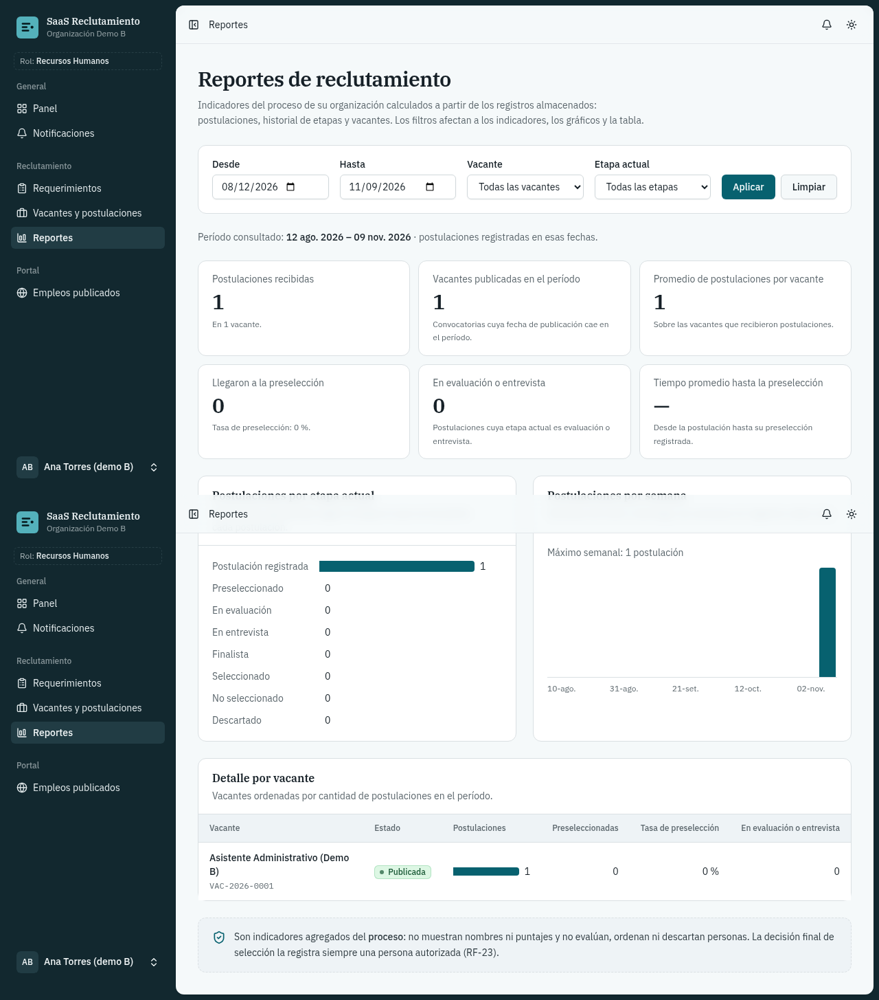

# Informe técnico individual

## 1. Portada

| | |
|---|---|
| **Universidad** | Universidad Continental |
| **Asignatura** | Pruebas y Calidad de Software (NRC 28607) |
| **Docente** | Dr. Maglioni Arana Caparachin |
| **Modalidad** | Individual |
| **Práctica** | Arquitectura de software, integración tecnológica, automatización de pruebas y reportes de impacto |
| **Proyecto** | SaaS Multiempresa para Reclutamiento, Evaluación y Selección de Personal |
| **Caso de estudio** | Colegio Andino de Huancayo (datos exclusivamente ficticios) |
| **Estudiante** | Luis Antonio Vila Meza |
| **Fecha** | 9 de noviembre de 2026 |
| **Versión del documento** | Fuente Markdown auditada por Codex; revisión humana y DOCX/PDF posteriores (rama `chore/sonarqube-macos-setup`, base `41a830c`, sin commit) |

*La asignatura, el NRC y el docente se tomaron del archivo de contexto del proyecto (`CLAUDE.md`).*

---

## 2. Descripción general del proyecto

El proyecto es una plataforma **SaaS multiempresa** para gestionar el reclutamiento, la evaluación y la selección de personal en instituciones educativas, con el Colegio Andino de Huancayo como caso de estudio. Cubre el ciclo completo: un área solicita personal (requerimiento), RR. HH. valida y Dirección aprueba; RR. HH. configura y publica la vacante con perfil y criterios ponderados; los postulantes se registran, cargan su CV y postulan; RR. HH. preselecciona y programa evaluaciones y entrevistas; los evaluadores registran puntajes; el sistema calcula un ranking explicable; **Dirección decide con confirmación humana y justificación (RF-23)**; RR. HH. registra la selección y cierra el proceso, y toda acción crítica queda en una auditoría de solo inserción.

El sistema atiende cinco problemas identificados en un AS-IS **preliminar, pendiente de validación institucional**: información distribuida (P1), seguimiento manual (P2), evaluaciones heterogéneas (P3), comunicación manual (P4) e indicadores limitados (P5). La línea base funcional son los requisitos RF-01 a RF-27 (v1.0, tag `v1.0.0-academic`); la v1.1 (tag `v1.1.0-academic`) agregó, entre otros, un servicio experimental de riesgo operacional (RF-29, candidato).

**Aporte de esta práctica.** Se documentaron la arquitectura de software y la tecnológica del sistema real; se verificó y ejecutó la suite Cypress, ampliada con un spec nuevo; se ejecutó un análisis SonarQube nuevo (V3), y se implementó un **módulo de reportes** (RF-28, candidato) que resuelve el límite declarado en el informe v1.0 sobre P5: «No se implementaron tableros de indicadores de gestión».

Contratos que la práctica respeta: el sistema **nunca** selecciona ni descarta automáticamente; el aislamiento por organización (`organization_id`), las Policies y la auditoría append-only se preservan; solo se usan datos ficticios; no se versionan secretos; y no hubo commit, push ni merge.

---

## 3. Arquitectura de software

Documento completo: [`../arquitectura/ARQUITECTURA_SOFTWARE.md`](../arquitectura/ARQUITECTURA_SOFTWARE.md).

### 3.1 Tipo de arquitectura

**Monolito modular** en Laravel 13 con **frontend integrado** mediante Inertia 3 (React 19 + TypeScript), en un modelo **cliente-servidor**, ofrecido como **SaaS multiempresa** con aislamiento lógico por `organization_id` sobre una base PostgreSQL compartida. Completan la arquitectura un *worker* de colas (Redis) para notificaciones y un microservicio experimental FastAPI (RF-29), opcional y desactivado por defecto. No hay microservicios de negocio: todo el dominio vive en un único despliegue.

### 3.2 Capas y componentes

`Ruta (+ middleware) → Form Request (autorización y validación) → Controller delgado → Service → Model/Enum → PostgreSQL`. El lugar de la Policy/Gate depende del flujo: en Reportes se invoca desde `FormRequest::authorize()` **antes de validar y antes del controlador**. Los servicios de escritura aplican transacciones, auditoría y notificaciones; el servicio de Reportes solo lee. La BD aplica CHECK, FK y trigger append-only. En el cliente, las páginas React reciben *props* JSON de Inertia; Wayfinder genera rutas tipadas.

### 3.3 Módulos funcionales

Requerimientos (RF-01–04), Vacantes (RF-05–07), Portal y postulación (RF-08–11), Postulaciones y etapas (RF-12–15), Evaluación y entrevista (RF-16–20), Comparación y ranking (RF-21–22), Decisión humana, selección y cierre (RF-23–26), Auditoría (RF-27), Riesgo operacional experimental (RF-29) y, **nuevo, Reportes de reclutamiento (RF-28 candidato)**. Las responsabilidades y los roles de cada módulo están en el documento completo, §3.

### 3.4 Comunicación, datos y seguridad

- **Flujo**: navegador → HTTP (Inertia XHR) → middleware `auth` (sesión en Redis) → Form Request → Policy → servicio → Eloquent + `OrganizationScope` → PostgreSQL → *props* JSON → React.
- **Multitenencia**: `organization_id` en toda entidad de negocio, scope global, Policies que comparan rol y organización, validaciones `exists` acotadas a la organización y pruebas cross-tenant (PHPUnit y Cypress).
- **Autenticación**: Fortify con 2FA y passkeys. **Autorización**: 5 roles y Policies; el Gate `viewRecruitmentReports` se creó para el módulo nuevo.
- **Auditoría**: `AuditLogger` + trigger `audit_logs_append_only`.

### 3.5 Diagrama de arquitectura

Se **reutilizaron** los diagramas editables existentes `01_ARQUITECTURA_GENERAL_SAAS` (UI, backend, BD, Redis, cola, multitenencia y servicio ML) y `06_MAPA_MODULOS_SAAS` (módulos). Se **agregó** `17_MODULO_REPORTES_COMPONENTES`, que el `06` no podía representar porque es una fotografía anterior al módulo. Rutas y criterios en [`DIAGRAMAS_REFERENCIA.md`](../arquitectura/DIAGRAMAS_REFERENCIA.md).

### 3.6 APIs

| API o servicio | Funcionalidad | Información intercambiada | Justificación |
|---|---|---|---|
| Servicio de riesgo operacional (FastAPI propio, `ml-service/`) | Estimar el riesgo de demora del **proceso** de una vacante (RF-29, experimental) | *Features* agregadas del proceso → probabilidad y metadatos. Nunca datos de personas | Apoyo informativo al seguimiento del plazo; desactivado por defecto y con *fallback* |

No se usan APIs de terceros (pagos, geolocalización, mensajería o BI externo) porque el proceso no las requiere: no hay cobros ni ubicaciones, las notificaciones son internas (base de datos y correo con *driver* `log`) y los reportes se calculan dentro del monolito sin sacar datos del perímetro multiempresa. Los componentes internos se comunican por llamadas en proceso, SQL, Redis y HTTP/JSON (Inertia).

---

## 4. Arquitectura tecnológica

Documento completo: [`../arquitectura/ARQUITECTURA_TECNOLOGICA.md`](../arquitectura/ARQUITECTURA_TECNOLOGICA.md). Versiones **medidas** el 09/11/2026 ([log](../evidencias/tecnologia/versiones-entorno.log)).

| Componente | Tecnología | Versión | Propósito |
|---|---|---|---|
| Frontend | React + TypeScript + Tailwind CSS | 19.3.0 · 5.9.3 · 4.3.3 | Interfaz de usuario |
| Integración | Inertia.js (+ Wayfinder) | react 3.7.1 · laravel 3.3.4 | Cliente-servidor sin API separada |
| Backend | PHP | 8.4.25 | Lógica de negocio |
| Framework | Laravel (+ Fortify) | 13.31.0 (Fortify 1.39.0) | MVC, ORM, colas, Policies y autenticación |
| Base de datos | PostgreSQL | 17.11 | Persistencia transaccional |
| Caché, sesión y colas | Redis | 7.4.11 | Sesiones, caché y notificaciones |
| Entorno de desarrollo | macOS 27.2 arm64, Docker Desktop, zsh, VS Code, Claude Code/Codex | — | Desarrollo con contenedores; VS Code verificado en captura real |
| Control de versiones | Git + GitHub (+ GitHub Actions) | Git 2.54.0 | Ramas, PR y CI (build, `tsc`, PHPUnit) |
| Infraestructura | Docker Engine + Compose | 29.7.2 · v5.5.1 | `app`, `queue`, `postgres`, `redis` y perfil E2E |
| Automatización de pruebas | **Cypress** | 15.3.0 | E2E sobre la aplicación real |
| Pruebas complementarias | PHPUnit + PCOV · Vitest | 12.5.35 + 1.0.12 · 4.1.11 | Unidad e integración; cobertura |
| Análisis de calidad | **SonarQube** Community + SonarScanner | 26.10.0.133078 · 8.1.0.6389 | Análisis estático y Quality Gate |

**Diagrama tecnológico**: se reutilizan `02_DESPLIEGUE_DOCKER` (principal), `11_ESTRATEGIA_PRUEBAS_CALIDAD`, `16_FLUJO_GIT_DESARROLLO` y `01`.

**Entorno y despliegue.** El proyecto se ejecuta localmente con `docker compose up -d --wait` (healthchecks de `/health`, PostgreSQL y Redis) en `http://localhost:8000`. No existe despliegue productivo ni en la nube: la gobernanza vigente lo bloquea y los datos son ficticios. Las versiones se publican mediante rama → regresión local → PR → CI (GitHub Actions) → integración en `develop` y `main`, siempre con autorización del equipo.

---

## 5. Integración y automatización de pruebas con Cypress

Documentos: [`ESCENARIOS_CYPRESS.md`](../cypress/ESCENARIOS_CYPRESS.md), [`RESULTADOS_CYPRESS.md`](../cypress/RESULTADOS_CYPRESS.md) y [`CAJA_NEGRA_BLANCA.md`](../cypress/CAJA_NEGRA_BLANCA.md).

### 5.1 Configuración

Cypress 15.3.0 ya estaba integrado y se ejecuta en un contenedor (`cypress/included:15.3.0`, Electron) contra una aplicación aislada (`app-e2e`, base `reclutamiento_e2e`, reinicio protegido por token). `cypress verify`: COMPLETED. Configuración en `cypress.config.cjs`: `baseUrl` (`http://app-e2e:8000` en Compose), `testIsolation`, `retries: 0`, selectores `data-cy`, comandos propios (`loginAs` con `cy.session`, `resetDatabase`, `waitForQueue`) y fixtures de usuarios demo. No se reinstaló nada.

### 5.2 Escenarios

Se documentan **11 grupos de escenarios reales**, cada uno con su ficha (ID, funcionalidad, objetivo, precondiciones, datos, procedimiento, resultado esperado, resultado obtenido y estado): acceso válido e inválido, registro de requerimiento, validación de formularios, registro y edición de vacante, postulación, cambio de etapa, evaluación, flujo integral de 12 pasos entre módulos, aislamiento multiempresa y **reportes (spec nuevo `e2e-20-reports.cy.js`, 9 casos)**. La **eliminación no aplica por diseño**: las rutas de negocio excluyen `destroy` para preservar la trazabilidad, y las bajas se modelan como transiciones de estado con motivo.

### 5.3 Resultados

| Ejecución completa | Specs | Pruebas | Aprobadas | Fallidas | Pendientes/omitidas | % aprobación | Duración |
|---|---|---|---|---|---|---|---|
| 1 (antes de corregir las pruebas) | 21 | 94 | 87 | 7 | 0 | 92,55 % | 02:26 |
| 2 (recibida de Claude) | 21 | 94 | 94 | 0 | 0 | 100 % | 08:33 |
| Codex, estado recibido | 21 | 94 | 94 | 0 | 0 | 100 % | 02:46 |
| **Codex, regresión final** | **21** | **94** | **94** | **0** | **0** | **100 %** | **02:37** |

### 5.4 Errores encontrados

1. **DEF-14** (`e2e-16`, 6 fallas): la prueba exigía `role="cell"`, que el commit `a88cd3c` retiró de `DataTable` para corregir el hallazgo Sonar `typescript:S6843`. La prueba quedó desalineada porque Cypress no se ejecutó en aquella sesión. La semántica accesible de la tabla se mantiene; se ajustó la aserción al rol nativo de `<td>`.
2. **DEF-15** (`e2e-17`, 1 falla): `.type('{esc}')` hacía clic en el centro del panel móvil, que con la nueva entrada «Reportes» pasó a ser un enlace. Se envía Escape al elemento enfocado sin hacer clic.

Ninguna funcionalidad de la aplicación presentó fallas: ambos errores estaban en las pruebas y quedaron registrados en `docs/defects.md`. Una duración atípica de `e2e-03` (324 s, aprobada) no se reprodujo (4 s al repetirla) ; tampoco reapareció en las dos suites Codex (spec de 4 s en la final). La contención de recursos es una hipótesis sin telemetría causal, no una conclusión.

### 5.5 Caja negra y caja blanca

Cypress cumple el rol de **caja negra** (entradas y salidas observables sobre la app real). La **caja blanca** la cubren las pruebas PHPUnit y Vitest diseñadas sobre las ramas del código: por ejemplo, las dos ramas de la condición «alcanzó la preselección», la tasa `null` con cero postulaciones, la validación del rango máximo, la regla `exists` acotada a la organización y la Policy. Las 20 fichas están en `CAJA_NEGRA_BLANCA.md`.

---

## 6. Integración y análisis de calidad con SonarQube

Documento: [`../sonarqube/RESULTADOS_SONARQUBE.md`](../sonarqube/RESULTADOS_SONARQUBE.md).

### 6.1 Configuración y ejecución

Servidor SonarQube Community 26.10 en un contenedor local; proyecto `saas-reclutamiento-multiempresa`, configurado en `sonar-project.properties` (sin cambios); Quality Gate Sonar way; cobertura Clover de PHPUnit generada con PCOV. El token se lee del archivo privado local ignorado, se pasa por variable de entorno y no aparece en archivos versionables ni logs. El análisis **V3** se ejecutó el 09/11/2026 sobre el **working tree sin commit** (HEAD `41a830c` + cambios de la práctica): `EXECUTION SUCCESS`, tarea procesada SUCCESS (análisis recibido `009b62ce…`). Codex regeneró Clover y repitió el análisis el 09/11 a las 22:20 Lima: **EXECUTION SUCCESS y CE SUCCESS**, análisis `ff71984c-9177-40eb-b244-0468a15bbdf2`, mismo proyecto y configuración intacta.

### 6.2 Métricas

| Métrica | Resultado V3 | Interpretación |
|---|---|---|
| Quality Gate | **OK**, condiciones evaluadas | Cumple nueva cobertura ≥ 80 %, duplicación nueva ≤ 3 % y 0 issues nuevos |
| Bugs | 0 (A) | Sin hallazgos de fiabilidad detectados |
| Vulnerabilities | 0 (A) | Sin hallazgos detectados por los analizadores disponibles; no certifica ausencia de riesgos |
| Code Smells | 0 (A) | Sin deuda de mantenibilidad abierta |
| Security Hotspots | 0 | Nada por revisar |
| Coverage | 70,3 % global · 90,1 % `app/` · 0,0 % `resources/js` · **85,0 % código nuevo** | Backend bien cubierto; el frontend no envía LCOV |
| Duplicated Lines | 0,0 % | Sin duplicación |

### 6.3 Comparación con mediciones anteriores

V1 (20/10): Gate OK sin condiciones evaluadas, 5 issues (2 vulnerabilidades, 3 code smells) y cobertura del 66,5 %. V2 final (20/10): 0 issues; Gate OK **por Small Changes** (`ignoredConditions=true`) con New Coverage del **50 %, no 80 %**. Esta advertencia se verificó en la API y **se conserva como histórica**. V3 (09/11): Gate OK con la condición de cobertura **evaluada y cumplida** (85,0 %), cobertura global del 70,3 % y 0 issues.

### 6.4 Interpretación y mejoras

El 85 % de cobertura nueva combina un backend nuevo cubierto al ~100 % (TDD: 186 de 187 líneas) con 31 líneas TypeScript nuevas en 0 %. Esas líneas sí tienen pruebas Vitest y Cypress, pero Sonar no recibe LCOV. El Gate pasa porque el backend pesa más, no porque el frontend esté medido. No se detectaron vulnerabilidades por las reglas disponibles: el módulo nuevo solo lee, valida sus parámetros y usa consultas parametrizadas. La UI de Community Build advierte que su análisis de seguridad es limitado (por ejemplo SQL injection y XSS); **0 hallazgos no significa ausencia de vulnerabilidades**. Los componentes con más observaciones son `resources/js/` y `routes/` (sin cobertura) y, fuera de Sonar, la deuda de PHPStan (91), Pint (8) y Oxfmt. Mejoras propuestas: importar LCOV de Vitest (requiere una dependencia de desarrollo, que queda como decisión del equipo), cubrir la única línea pendiente del Form Request, sanear PHPStan, Pint y Oxfmt en un commit aislado, llevar el scanner a CI, planificar una instancia futura con PostgreSQL preservando el histórico H2, sin suponer una migración directa soportada y volver a ejecutar Cypress tras cada corrección guiada por Sonar (lección de DEF-14).

**Evidencias UI cerradas:** siete capturas reales del panel, obtenidas con la sesión ya abierta, sin credenciales expuestas; lista en `RESULTADOS_SONARQUBE.md` §7. UI en MQR mode, contrastada con las métricas tradicionales de la API.

Las cinco reglas originales siguen **CLOSED/FIXED**, comprobadas por ID de regla. New Code mantiene 220 líneas elegibles, 187 cubiertas y 33 descubiertas; no se tocaron umbrales ni exclusiones.

---

## 7. Implementación del módulo de reportes

Documento: [`../reportes/MODULO_REPORTES.md`](../reportes/MODULO_REPORTES.md).

**Ubicación.** `GET /reportes`, en el menú «Reportes» de RR. HH. y de Dirección. Componentes: `RecruitmentReportController` (delgado), `RecruitmentReportRequest` (filtros y autorización), `RecruitmentReportPolicy` (Gate `viewRecruitmentReports`), `RecruitmentReportService` (cálculo), la página `reports/index.tsx` y `lib/reports.ts`. **Sin migraciones ni dependencias nuevas**: los gráficos son barras HTML/CSS con los tokens del tema.

**Indicadores (6)**: postulaciones recibidas; vacantes publicadas en el período; promedio de postulaciones por vacante; postulaciones que llegaron a la preselección y su tasa; en evaluación o entrevista; tiempo promedio hasta la preselección.

**Reportes estadísticos**: barras por etapa actual (embudo), columnas por semana y tabla de detalle por vacante.

**Filtros**: Desde, Hasta, Vacante y Etapa actual, validados en el servidor. Período y vacante afectan a todos los KPI, gráficos y tabla; la etapa afecta al conjunto de postulaciones (cinco KPI), gráficos y tabla. **Vacantes publicadas no se filtra por etapa**, pues mide `vacancies.published_at`, no el estado de una postulación.

**Datos reales**: todo se calcula con consultas a `applications`, `application_stage_histories` y `vacancies`. En local, los registros son de demostración (`DemoSeeder`), ficticios y **almacenados en la BD** a través de los servicios reales. Una prueba E2E demuestra que el reporte cambia al registrar una preselección en la UI (8 → 9).

**Multitenencia**: Gate (rol + organización), scope global, `where organization_id` explícito en todas las consultas (defensa en profundidad), filtro de vacante validado contra la organización y selector limitado a vacantes propias.

**Pruebas**: 12 Feature PHPUnit (RED histórico documentado por el implementador → GREEN repetido por Codex, 209 aserciones), 6 Vitest y 9 Cypress. Cubren acceso autorizado, roles denegados, cálculo exacto, gráficos y tabla, aislamiento, filtro de otra organización, período, vacante y etapa, validaciones, ausencia de datos personales y organización vacía.

---

## 8. Análisis del impacto funcional del software

Documento: [`../reportes/IMPACTO_FUNCIONAL.md`](../reportes/IMPACTO_FUNCIONAL.md).

- **Problema**: digitalizar un proceso de reclutamiento con información distribuida, seguimiento manual y, en lo que atañe al módulo, **indicadores limitados (P5)**. El informe v1.0 había declarado que no existían tableros de gestión.
- **Qué muestra el módulo**: volumen, avance a la preselección, carga de evaluación, tiempos, embudo por etapa, tendencia semanal y detalle por vacante, sin datos personales.
- **Indicadores de evaluación del proceso**: la tasa de preselección (ajuste del perfil publicado), el tiempo hasta la preselección (demora de la primera revisión), la distribución por etapa (cuellos de botella) y las postulaciones por vacante y semana (alcance de la difusión).
- **Toma de decisiones**: RR. HH. prioriza revisiones y difusión y anticipa la carga de los evaluadores; Dirección supervisa sin pedir reportes manuales. El módulo no decide sobre personas.
- **Actividades optimizables**: control del avance (O-02), consolidación de información (O-05), primera revisión de postulaciones, planificación de evaluaciones y difusión de convocatorias.

**Resultados medidos** (verificados por ejecución): cálculo exacto con datos controlados; valores de la demo (organización A: 9 postulaciones y 88,9 % de preselección; organización B: 1); reflejo inmediato de un cambio; aislamiento entre organizaciones; filtros efectivos; ausencia de datos personales; y una sola pantalla que reemplaza la consulta vacante por vacante.

**Beneficios potenciales** (no medidos): detección temprana de vacantes con baja respuesta, reducción de la demora de preselección, equilibrio de la carga de evaluación, ahorro en reportes manuales y mejor sustento de las decisiones de gestión. **No se presenta ninguna mejora porcentual**: el AS-IS no está validado, los datos reales están prohibidos por la gobernanza del proyecto y los datos disponibles son sintéticos (el tiempo de preselección de la demo es ≈ 0 días porque todo se crea en el mismo instante). Para cada beneficio se propone cómo medirlo en el futuro.

---

## 9. Conclusiones

1. La arquitectura real es un **monolito modular Laravel con frontend React integrado mediante Inertia**, cliente-servidor y multiempresa por `organization_id`. Responde al tamaño del dominio y a la necesidad de autorizar todo en el servidor; los diagramas existentes la representan correctamente y solo hizo falta un diagrama nuevo para el módulo de reportes.
2. El stack tecnológico (PHP 8.4, Laravel 13, React 19, PostgreSQL 17, Redis 7, Docker, Cypress 15, SonarQube 26.10) se documentó con **versiones medidas**, no supuestas.
3. **Cypress** aportó valor real: la primera ejecución completa (92,55 %) encontró dos defectos en las pruebas, uno de ellos introducido por una corrección de SonarQube que no se había validado de extremo a extremo. Tras corregirlos, la suite aprobó **94/94 (100 %)**.
4. **SonarQube V3** dio Quality Gate OK **con las condiciones evaluadas** (85,0 % de cobertura nueva), sin bugs, vulnerabilidades, code smells ni hotspots. La interpretación muestra que la cobertura de frontend sigue siendo invisible para Sonar: el resultado es bueno, pero no completo. El histórico «OK por Small Changes, 50 %» se conservó como tal.
5. El **módulo de reportes** cierra la brecha P5 declarada en v1.0 con 6 indicadores, 2 gráficos, una tabla y 4 filtros calculados desde la BD, con aislamiento multiempresa verificado en tres niveles de prueba y sin tocar datos de personas ni la decisión humana.
6. El impacto se expresa con honestidad: hay resultados funcionales medidos, pero no mejoras de proceso cuantificadas, que requieren validar el AS-IS y autorizar datos reales.

**Trabajo futuro**: cobertura LCOV de frontend en Sonar, análisis en CI, saneamiento de PHPStan, Pint y Oxfmt, decisión del equipo sobre promover RF-28 al baseline, exportación del reporte (candidato RF-30) y línea base institucional para medir el impacto.

---

## 10. Anexos y evidencias

- **A. Matriz de requisitos de la guía**: [`../requisitos/MATRIZ_REQUISITOS.md`](../requisitos/MATRIZ_REQUISITOS.md).
- **B. Matriz de rúbrica**: [`../requisitos/MATRIZ_RUBRICA.md`](../requisitos/MATRIZ_RUBRICA.md).
- **C. Manifiesto de evidencias** (32 registros principales, 32 disponibles; 7 capturas Sonar UI y 1 IDE adicionales): [`../evidencias/EVIDENCIAS_MANIFEST.md`](../evidencias/EVIDENCIAS_MANIFEST.md).
- **D. Código del módulo**: `routes/web.php`, `app/Policies/RecruitmentReportPolicy.php`, `app/Http/Requests/Reports/RecruitmentReportRequest.php`, `app/Http/Controllers/Reports/RecruitmentReportController.php`, `app/Services/Reports/RecruitmentReportService.php`, `resources/js/pages/reports/index.tsx` y `resources/js/lib/reports.ts`.
- **E. Pruebas**: `tests/Feature/Reports/RecruitmentReportTest.php`, `resources/js/lib/reports.test.tsx` y `cypress/e2e/e2e-20-reports.cy.js`.
- **F. Defectos encontrados**: DEF-14 y DEF-15 en [`docs/defects.md`](../../defects.md).
- **G. Diagramas**: [`../arquitectura/DIAGRAMAS_REFERENCIA.md`](../arquitectura/DIAGRAMAS_REFERENCIA.md).
- **H. Regresión final independiente**: PHPUnit **434 total = 426 aprobadas + 8 omitidas, 0 fallidas, 1715 aserciones** · Vitest **54/54** (Reportes 6/6) · `tsc` **0 errores** · build **PASS** · Cypress **21 specs, 94/94, 0 fallidas/omitidas, 02:37** (Reportes 9/9).
- **I. Auditoría independiente**: [`AUDITORIA_CODEX.md`](../AUDITORIA_CODEX.md), logs y JSON en [`evidencias/codex/`](../evidencias/codex/). Se corrigieron solo PHPDoc del servicio (14 errores nuevos eliminados); PHPStan global conserva **91** errores históricos, Pint **8** archivos y Oxlint **5 warnings, 0 errores**. `npm run check` sigue fallando por formato histórico, sin formateo automático.
- **J. IDE real**: [VS Code](../evidencias/arquitectura/ARQ-TECH-09_IDE_VSCode.jpg). La matriz contiene **59 requisitos únicos**, 59 completos materialmente para este informe Markdown; no 52. Estimación conservadora de rúbrica: **19/20**, no calificación docente.

**Incidencia de instrumentación documentada:** un primer intento de PHPUnit en paralelo con el build obtuvo 1 fallo por un CSS de fuente ausente mientras se reconstruía el manifiesto (425 passed, 8 skipped). Se repitió de forma secuencial tras terminar el build y pasó 426+8; luego Clover y Cypress también pasaron. Se conserva el intento fallido en `evidencias/codex/phpunit-final.log`, sin ocultarlo ni cambiar producción para acomodarlo.

**Cierre local:** LISTO PARA CIERRE técnico de esta práctica, sujeto a revisión humana del diff y posterior generación autorizada de DOCX/PDF. No es aprobación productiva ni saneamiento de toda la deuda. No hubo staging, commit, push, merge, rebase ni cambios de rama; el ML sigue desactivado y los históricos se conservan.
